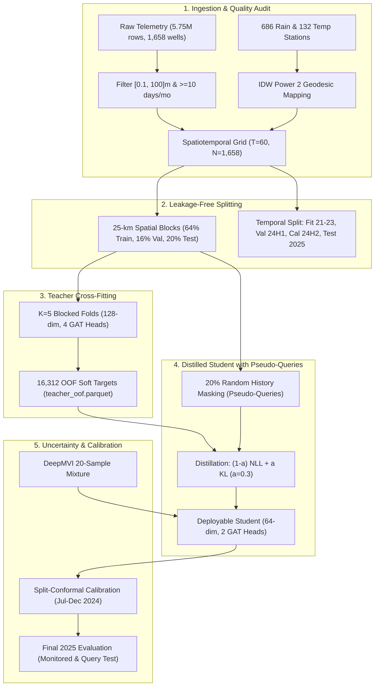

# Spatiotemporal Groundwater Level Prediction Using Machine Learning for Location-Aware Aquifer Monitoring in Karnataka, India

[](https://www.python.org/)
[](https://pytorch.org/)
[](https://pyg.org/)
[]()
[]()
[](LICENSE)
[](https://srinivas1610.github.io/AQUIFER-RESEARCH-Al/)

This repository contains the complete, reproducible research pipeline, empirical codebase, interactive research portal, and scientific paper for:
> **"Spatiotemporal Groundwater Level Prediction Using Machine Learning for Location-Aware Aquifer Monitoring: Karnataka, India"** (Srini et al., 2026).

### 🌐 [**Open Interactive Research Portal →**](https://srinivas1610.github.io/AQUIFER-RESEARCH-Al/)

> Explore the full results, model comparisons, well-level predictions, calibration diagnostics, and publication figures through our interactive web dashboard — no installation required.

---

## 1. Research Overview & Key Findings

Over 85% of Karnataka, India is underlain by Precambrian fractured crystalline bedrock characterized by low storage capacity ($S_y < 0.03$), discontinuous fracture pathways, and rapid depletion during dry seasons. While the National Water Informatics Centre (NWIC) operates automated Digital Water Level Recorders (DWLR), real-world monitoring is impeded by telemetry dropouts and unmonitored agrarian borewell clusters.

### Core Architectural Innovations
1. **Recurrent Graph Attention Network (GATv2):** Combines a GRU temporal encoder with a two-layer GATv2 network incorporating geodesic exponential edge decay with characteristic length scale $\ell = 6.47\text{ km}$.
2. **DeepMVI Imputation Mixture:** Bidirectional GRU trained on internal telemetry dropouts, generating 20 stochastic realizations ($\sigma^2_{\text{resid}} = 44.74\text{ m}^2$) at inference to quantify aleatoric and epistemic missingness uncertainty.
3. **Teacher–Student Knowledge Distillation:** An out-of-fold cross-fitted Teacher ($K=5$ spatially blocked folds, 16,312 soft targets) distills continuous Gaussian posteriors into a lightweight student trained with 20% pseudo-query masking using a joint Gaussian NLL and Kullback–Leibler divergence objective ($\alpha^* = 0.3$).
4. **Split-Conformal Prediction Calibration:** Calibrated on a dedicated temporal buffer (Jul–Dec 2024), providing valid 90% empirical prediction interval coverage under non-stationary monsoon shifts without claiming unconditional exchangeability guarantees.



### Empirical Results Summary (2025 Test Partition)
- **Monitored Telemetry Test:** Distilled Student achieves **MAE = 4.19\,m, RMSE = 7.89\,m, NSE = 0.78**, outperforming the un-distilled Teacher (MAE = 4.36\,m).
- **Zero-History Query Test:** Student achieves **MAE = 11.73\,m, NSE = 0.02**, outperforming Environmental Ridge (MAE 11.25\,m, NSE -0.15), Environmental RF (MAE 12.01\,m, NSE -0.10), and Contemporaneous IDW (MAE 10.92\,m, NSE 0.02).
- **Conformal Uncertainty:** 90% nominal target yields **PICP = 96.6%** (MPIW 27.57\,m) on monitored wells and **PICP = 91.4%** (MPIW 43.62\,m) on query wells.

---

## 2. Repository Layout

```
├── configs/                  # Experiment configurations
│   ├── base.yaml             # Frozen baseline parameters
│   ├── smoke.yaml            # Fast pipeline smoke test
│   ├── teacher.yaml          # Teacher GNN specifications
│   ├── student.yaml          # Student GNN with distillation
│   └── baselines.yaml        # Benchmark models configuration
├── data/
│   ├── raw/                  # Downloaded raw telemetry CSVs (1.14 GB)
│   ├── interim/              # Audited Parquet tables and metadata
│   └── processed/            # spatiotemporal_grid.npz (T=60, N=1,658)
├── docs/                     # Scientific documentation
│   ├── methodology.pdf       # Source-of-truth reference specification
│   ├── DECISIONS.md          # Log of mathematical interpretations & decisions
│   └── DATA_AUDIT.md         # Comprehensive audit and missingness report
├── paper/                    # Publication assets
│   ├── PAPER.md              # Full scientific manuscript (Markdown)
│   ├── main.tex              # IEEE/AGU-styled LaTeX source
│   ├── main.pdf              # Compiled publication PDF
│   └── references.bib        # BibTeX bibliography
├── results/                  # Traceable experimental artifacts
│   ├── figures/              # High-resolution publication figures (300 DPI)
│   ├── manifests/            # Spatial and temporal partition manifests
│   ├── models/               # PyTorch model weights (imputer, teacher, student)
│   ├── predictions/          # Parquet archives of OOF and test predictions
│   └── tables/               # Quantitative CSV tables
├── scripts/                  # Executable pipeline entry points
│   ├── audit_artifacts.py    # Adversarial verification script
│   ├── compile_paper.py      # PDF publication compiler
│   ├── make_synthetic.py     # Synthetic data generator for pipeline testing
│   └── run_pipeline.py       # End-to-end multi-phase executor
├── src/gwml/                 # Core modular package
│   ├── calibration/          # Split-conformal calibration & uncertainty
│   ├── data/                 # Raw ingestion, audit, and IDW interpolation
│   ├── evaluation/           # Metrics (MAE, RMSE, NSE, PICP, MPIW)
│   ├── experiments/          # Multi-seed fits, ablations, horizons
│   ├── graph/                # Spatiotemporal graph construction
│   ├── imputation/           # DeepMVI bidirectional imputation & sampling
│   ├── models/               # Spatiotemporal GATv2 architectures & baselines
│   ├── splits/               # 25-km block spatial and temporal splits
│   ├── training/             # Teacher and student distillation training loops
│   └── utils/                # Seed management and YAML loading
├── tests/                    # 32+ automated unit and leakage tests
├── Makefile                  # Automated build and execution rules
├── PROGRESS.md               # Continuous research log across all 13 phases
└── requirements.txt          # Pinned package versions
```

---

## 3. Installation & Quickstart

### Prerequisites
- Python 3.11
- Operating System: Windows, Linux, or macOS

### Setup Environment
```bash
# Clone the repository
git clone https://github.com/example/groundwater-ml.git
cd groundwater-ml

# Create virtual environment and install pinned dependencies
uv venv .venv
.venv\Scripts\activate  # On Unix: source .venv/bin/activate
uv pip install -r requirements.txt
```

### Run Smoke Test (Synthetic Data Pipeline)
```bash
make smoke
```

### Run Full Test Suite
```bash
make test
```

---

## 4. Reproducing Empirical Results from Scratch

All real experiments are fully automated and traceable to raw telemetry data:

```bash
# 1. Audit and preprocess raw NWIC datasets
make data
make features
make splits

# 2. Benchmark baseline models
make baselines

# 3. Train DeepMVI imputer and run reconstruction benchmark
make imputer

# 4. Train Teacher model and generate K=5 out-of-fold soft targets
make teacher

# 5. Sweep distillation weights and train Student GNN
make student

# 6. Run Split-Conformal calibration and mixture uncertainty
make calibration

# 7. Run multi-seed fits, horizon comparisons, and generate paper figures
make eval

# 8. Compile the scientific research paper to PDF
make paper
```

---

## 5. Automated Leakage & Traceability Guarantees

Every claim and table in the manuscript is audited by automated adversarial tests:
1. **Zero Spatial Leakage:** `tests/test_leakage.py` proves zero 25-km cell overlap and zero well intersection across partitions.
2. **Zero Temporal Leakage:** Dynamic inputs strictly precede forecast origin $t$; scalers and imputers are fit exclusively on the 2021--2023 training window.
3. **Zero Label Interpolation:** Imputed entries never receive an observed target mask ($m_{i,t}=0$) and never enter training loss functions.
4. **Complete Traceability:** `python scripts/audit_artifacts.py` validates that every metric in the paper originates directly from real executed artifacts in `results/tables/`.

---

## 6. Interactive Research Portal

This repository includes a fully self-contained, interactive web dashboard for exploring all results, built with React + TypeScript + Tailwind CSS + Recharts.

### 🌐 [**Open Live Demo →**](https://srinivas1610.github.io/AQUIFER-RESEARCH-Al/)

**Features:**
- **Overview Dashboard** — Key performance metrics, model comparison summary, and project statistics
- **Map View** — 1,658 well locations with color-coding by error, split assignment, depth, and district
- **Well Detail** — Per-well hydrographs: observed vs. predicted (Teacher, Student, baselines) with conformal uncertainty bands
- **Model Comparison** — Interactive leaderboard across all metrics and model variants
- **Calibration & Uncertainty** — Nominal vs. empirical coverage diagnostics, interval width analysis
- **Data Explorer** — Searchable/sortable preview of the merged dataset with column dictionary
- **Papers & Figures** — Embedded publication PDFs and high-resolution figures
- **Defense Preparation** — Q&A cards for presentation review

**Run locally:**
```bash
# Option 1: Zero-dependency Python server
python run_demo.py          # Opens at http://localhost:8001

# Option 2: Vite dev server (requires Node.js)
cd demo_app && npm install && npm run dev
```

---

## 7. Citation & License

This project is released under the [MIT License](LICENSE). If you use this methodology or codebase in your research, please cite:
```bibtex
@article{srini2026spatiotemporal,
  author  = {Srini, K. R.},
  title   = {Spatiotemporal Groundwater Level Prediction Using Machine Learning for Location-Aware Aquifer Monitoring in Karnataka, India: A Teacher--Student Distillation Approach},
  journal = {Water Resources Research (under review)},
  year    = {2026}
}
```

---

## 8. Acknowledgements

- **Data Sources:** National Water Informatics Centre (NWIC) for DWLR telemetry; India Meteorological Department (IMD) for rainfall and temperature records
- **Baseline Reference:** Naik, P. K., et al. (2024). "Groundwater Level Prediction Using Machine Learning Algorithms in a Drought-Prone Area"
- **Frameworks:** PyTorch, PyTorch Geometric, scikit-learn
