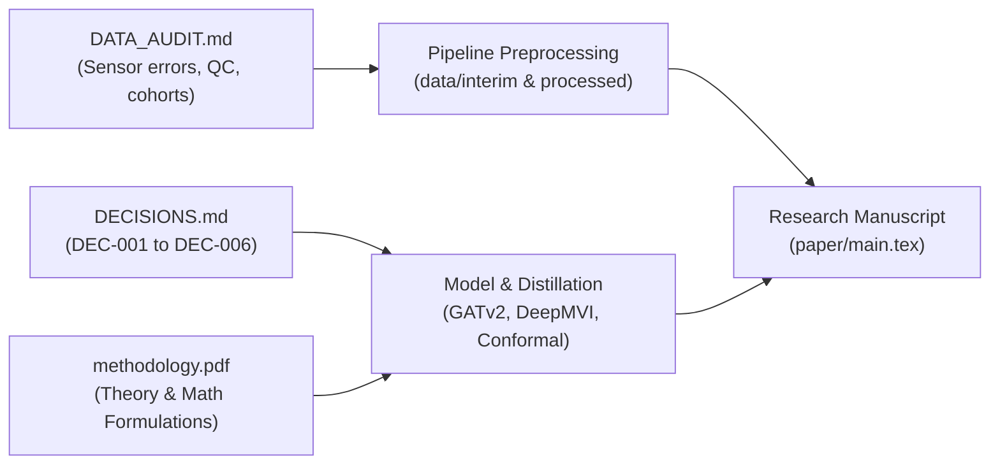

# Research Documentation & Design Traceability

This directory serves as the centralized repository for foundational research documentation, data quality audits, methodological derivations, and the architectural decision log supporting:
> **"Spatiotemporal Groundwater Level Prediction Using Machine Learning for Location-Aware Aquifer Monitoring in Karnataka, India"**

These records provide complete, end-to-end traceability for every empirical and design choice made throughout the research lifecycle, ensuring transparency, mathematical rigor, and exact scientific reproducibility.

---

## 1. Documentation Inventory

| File Name | Format | Primary Scope | Description |
|---|---|---|---|
| [`DATA_AUDIT.md`](file:///c:/Users/srini/Desktop/SEM%20V/ML/ML%20PROJECT/ml/docs/DATA_AUDIT.md) | Markdown | Quality Audit & Ingestion Policy | Exhaustive data audit report detailing raw sensor records, telemetry spike detection, coordinate validation, missingness patterns, and temporal aggregation rules. |
| [`DECISIONS.md`](file:///c:/Users/srini/Desktop/SEM%20V/ML/ML%20PROJECT/ml/docs/DECISIONS.md) | Markdown | Chronological Architecture Log | Formal record of all technical decisions (DEC-001 through DEC-006), resolving methodological ambiguities and documenting structural design choices with empirical rationale. |
| [`methodology.pdf`](file:///c:/Users/srini/Desktop/SEM%20V/ML/ML%20PROJECT/ml/docs/methodology.pdf) | PDF | Supplementary Methodology Specification | Formal supplementary research proposal and mathematical formulation defining system architecture, physical assumptions, loss functions, and evaluation criteria. |
| [`methodology_extracted.txt`](file:///c:/Users/srini/Desktop/SEM%20V/ML/ML%20PROJECT/ml/docs/methodology_extracted.txt) | Plain Text | Plaintext Reference Extraction | Clean text extraction of `methodology.pdf` designed for programmatic reference, pipeline cross-referencing, and automated verification. |

---

## 2. Scope and Contents of Core Documents

### 2.1 Data Quality Audit (`DATA_AUDIT.md`)
[`DATA_AUDIT.md`](file:///c:/Users/srini/Desktop/SEM%20V/ML/ML%20PROJECT/ml/docs/DATA_AUDIT.md) establishes the empirical baseline across 5.75 million raw observations from January 2021 to December 2025:
- **Spatial Verification:** Validated 1,658 monitoring wells and excluded 140 stations with missing coordinates; corrected coordinate format anomalies.
- **Sensor Error Detection & Spike Removal:** Filtered extreme telemetric artifacts (ranging from $-1.56 \times 10^9\text{ m}$ to $+9.5 \times 10^6\text{ m}$) by enforcing strict physical hydrogeological bounds $[0.1\text{ m}, 100.0\text{ m bgl}]$, removing 193,867 non-physical readings (3.4%).
- **Reference Datum Standardization:** Inverted negative DWLR readings below ground level ($m\text{ bgl}$) into positive depth values.
- **Aggregation & Missingness Thresholds:** Aggregated 6-hourly telemetry into daily medians, followed by monthly medians requiring $\ge 10$ active observation days per month. Documented that 59,065 well-months (59.4%) represent genuine observed labels, while 40,415 missing entries (40.6%) are explicitly tracked and never artificially interpolated.
- **Cohort Stratification:** Identified the 260-well core training cohort ($\ge 70\%$ valid targets in 2021–2023) and defined the official chronological partition matrix across initial training, validation, refit, calibration, and test phases.

### 2.2 Architectural Decision Log (`DECISIONS.md`)
[`DECISIONS.md`](file:///c:/Users/srini/Desktop/SEM%20V/ML/ML%20PROJECT/ml/docs/DECISIONS.md) records the explicit rationale for deviations, formalizations, and protocol choices:
- **DEC-001 (Chronological Partitioning):** Adopted the non-overlapping progression (Train: 2021–2023, Validation: Jan–Jun 2024, Refit: 2021–Jun 2024, Calibration: Jul–Dec 2024, Test: 2025) to prevent temporal data leakage.
- **DEC-002 (Scientific Tense Convention):** Established academic past-tense reporting across all experimental deliverables.
- **DEC-003 (DeepMVI Sampling):** Configured bidirectional GRU gap reconstruction for retrospective imputation and truncated autoregressive inputs for forward forecasting, calibrated to residual variance ($\sigma^2_{\text{resid}} = 44.74\text{ m}^2$) over 20 stochastic realizations.
- **DEC-004 (OOF Teacher–Student Distillation):** Mandated $K=5$ spatially blocked cross-fitting for teacher soft targets (`teacher_oof.parquet`) to prevent target memorization and over-confidence transfer.
- **DEC-005 (Split-Conformal Prediction Caveats):** Formalized calibration on the Jul–Dec 2024 buffer while documenting the theoretical non-exchangeability boundary caused by monsoonal regime shifts.
- **DEC-006 (Missingness Policy):** Enforced strict prohibition of seasonal interpolation into true observed target masks.

### 2.3 Supplementary Methodology (`methodology.pdf` & `methodology_extracted.txt`)
[`methodology.pdf`](file:///c:/Users/srini/Desktop/SEM%20V/ML/ML%20PROJECT/ml/docs/methodology.pdf) (and its plaintext twin [`methodology_extracted.txt`](file:///c:/Users/srini/Desktop/SEM%20V/ML/ML%20PROJECT/ml/docs/methodology_extracted.txt)) outlines the mathematical underpinnings of the research:
- Graph construction using geodesic distance decaying adjacency matrices ($A_{ij} = \exp(-d_{ij}/\ell)$).
- Recurrent spatiotemporal encoding via GRU cells paired with Graph Attention Network (GATv2) layers.
- Task definitions across three regimes: forecasting at monitored wells, retrospective gap reconstruction, and zero-history spatial query prediction.
- Objective formulations including negative log-likelihood (NLL), Kullback–Leibler (KL) divergence, and conformal quantile nonconformity scores.

---

## 3. Scientific Traceability & Reproducibility Guarantee

Every empirical claim, data preprocessing filter, and architectural hyperparameter presented in the research paper directly maps to a documented decision or data audit result:

This explicit documentation structure ensures that independent researchers can trace every preprocessing step, design rationale, and model constraint from raw telemetry ingestion through to publication-grade experimental evaluation.
